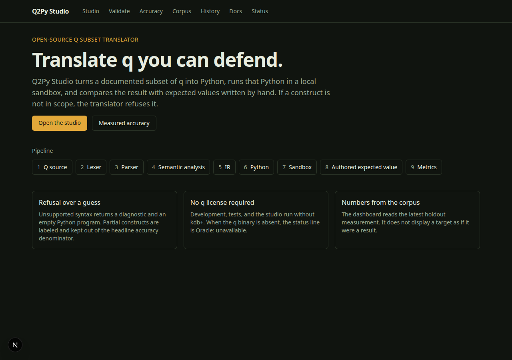
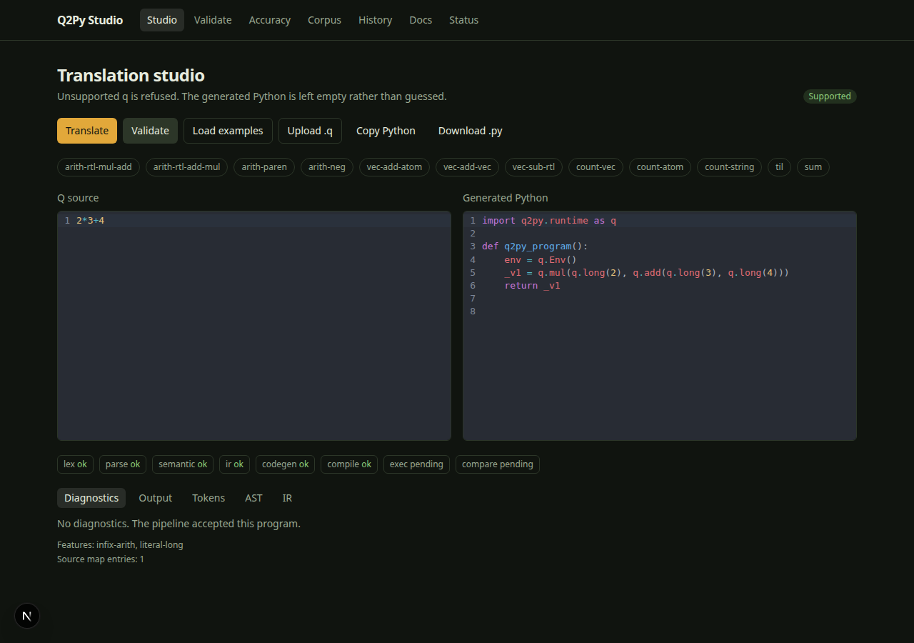
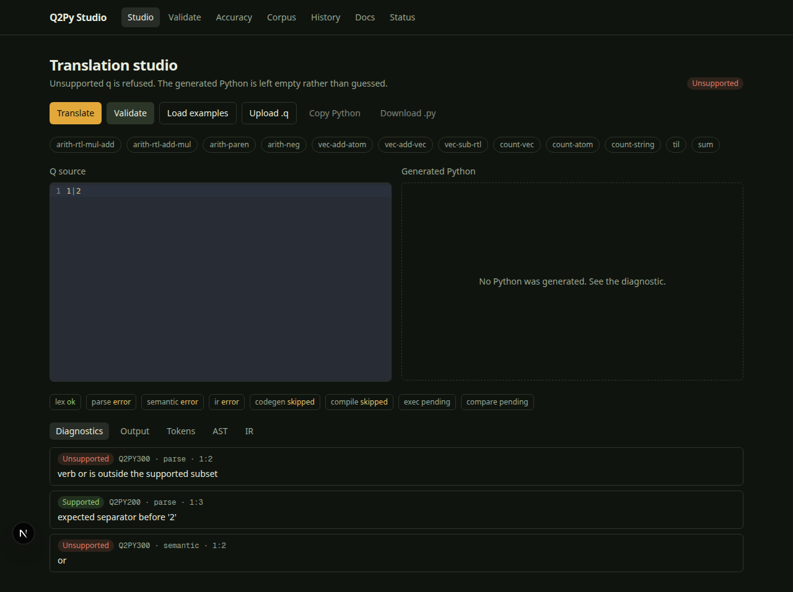
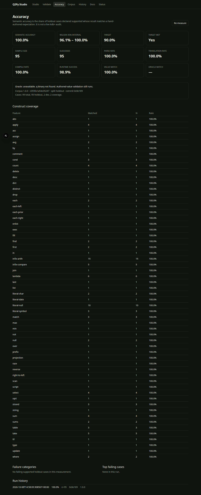

# Q2Py Studio

Q2Py Studio translates a documented subset of q/kdb+ into Python, runs that Python in a local sandbox, and compares the result with expected values stored in the repository. If a construct is unsupported, the translator returns a diagnostic and does not invent Python.

A kdb+ license is not required to develop, test, run, or deploy this project. When the `q` binary is absent, the API and dashboard report **Oracle: unavailable**.

## Measured holdout result

This is agreement with hand-authored expectations in `corpus/cases.json`. It is not a live q audit. Re-run the scorer after you clone; the `commit` field is whatever `git rev-parse --short HEAD` was at measurement time.

On this tree, `PYTHONPATH=src python -m q2py.score` reported:

| Metric | Value |
| --- | --- |
| Corpus | 1.0.0, hash `c055fa1a54e35247` |
| Holdout sample (declared support `supported`) | 95 |
| Successes | 95 |
| Semantic accuracy | 1.0 |
| Wilson 95% interval | 0.9611 – 1.0 |
| Target | 0.90 (met on this measurement) |
| Parse / translation / compile / value-match | 1.0 |
| Runtime success | 0.9895 |
| Oracle match | null |
| Oracle | `oracle-unavailable` (`q` binary not found) |

The runtime-success rate is below 1 because one holdout case expects a q length signal. That case matches the signal and does not count as a successful run. Partial and coverage cases are outside the accuracy denominator. Corpus size is 99 cases: 95 holdout, 2 dev, 2 coverage.

## Run

```sh
python3.12 -m venv .venv
.venv/bin/pip install -e ".[dev]"
cd apps/web && npm ci && cd ../..
sh scripts/dev.sh
```

- [Studio](http://127.0.0.1:43117)
- API on port 43118, prefix `/api/v1`

Pages: landing, translation studio, validation, accuracy dashboard, corpus, history, documentation, status, plus 404 and 500.

## Test

```sh
.venv/bin/ruff check src tests
.venv/bin/mypy --strict src/q2py
.venv/bin/pytest
cd apps/web && npm test && npm run lint && npm run build
```

## API

| Method | Path | Purpose |
| --- | --- | --- |
| GET | `/api/v1/health` | Process up |
| GET | `/api/v1/status` | Version, oracle, corpus, sandbox limits |
| POST | `/api/v1/translate` | `{ "source" }` |
| POST | `/api/v1/validate` | `{ "source", "case_id"? }` |
| GET | `/api/v1/corpus` | Authored cases |
| GET | `/api/v1/examples` | Short example list |
| GET | `/api/v1/metrics` | Scores the holdout and stores a snapshot |
| GET | `/api/v1/history` | Recent events |

## Screenshots

Taken from the running app in headless Chrome. The dashboard’s commit field is the git HEAD at capture time.









## Layout

- `src/q2py` — lexer, parser, IR, codegen, runtime, sandbox, corpus, API
- `corpus/cases.json` — independent expectations
- `apps/web` — Next.js studio
- `docs/` — architecture, methodology, constructs, limitations, types, security, deployment

## Deployment

See `docs/deployment.md`. The Docker image runs the API only. The product keeps a SQLite file and executes Python in a subprocess, so it is a long-running service rather than a serverless function.
